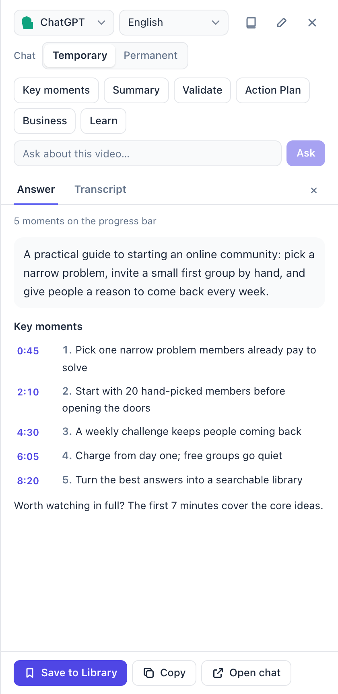
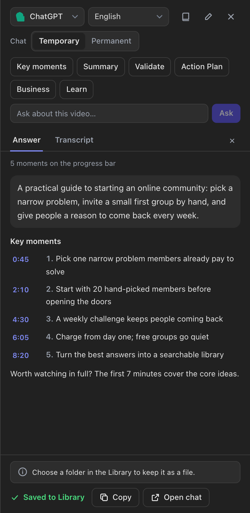
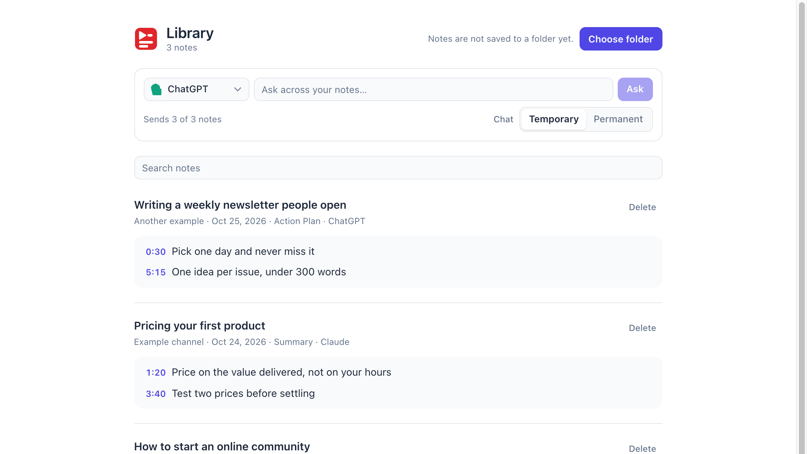

<div align="center">


# YouTube Script

**Turn any YouTube video into key ideas you can jump to, keep and search.**

A sidebar next to the video with the transcript and an AI analysis full of clickable times.
It runs on the ChatGPT or Claude you're already logged into: no API key, no extra subscription.



&nbsp;&nbsp;


<sub>Example answer. Light theme, and dark theme right after <b>Save to Library</b>.</sub>

</div>

---

## ✨ What it does

- ⏱️ **Skip to the good part.** Key moments with clickable times, also shown as yellow dots on YouTube's progress bar.
- 🤖 **No API key.** ChatGPT and Claude get the prompt filled in and sent for you, in your own account. The answer shows up in the sidebar as it's written.
- 🕶️ **Temporary chats by default.** Analyses stay out of your ChatGPT / Claude history and memory. Switch to **Permanent** whenever you want to keep a chat.
- 📚 **A library for what you watch.** Save the key ideas, search them later, and ask questions across all your notes. Every note can also be a Markdown file in a folder you pick (an Obsidian vault works).
- 🌍 **Your language.** Answers in English, Italian, French, German, Spanish, Portuguese, or the video's own language.

---

## 🚀 Install

It's not on the Chrome Web Store yet, so you build it once from the source. It takes about 5 minutes.

**You need:** Google Chrome (or another Chromium browser), [Node.js](https://nodejs.org) 20.19 or newer, and Git.

```bash
git clone https://github.com/Sghibiri/youtube-script.git
cd youtube-script
npm install
npm run build
```

Then load it into Chrome:

1. Go to `chrome://extensions`
2. Turn on **Developer mode** (top right)
3. Click **Load unpacked** and pick the `.output/chrome-mv3` folder inside the project
4. Optional: click the puzzle icon in the toolbar and pin **YouTube Script**

> [!TIP]
> On a Mac, `.output` is hidden in the folder picker. Press <kbd>⌘</kbd> <kbd>Shift</kbd> <kbd>.</kbd> to show it.

**Updating:** run `git pull && npm install && npm run build`, click ↻ on the extension's card in `chrome://extensions`, then reload your YouTube tabs.

---

## 🎬 How to use it

### 1. Open the sidebar

Open a YouTube video or Short that has captions. Click the extension icon in the toolbar, or the red tab on the right edge of the page. The transcript loads right away.

On windows at least 900 px wide, the sidebar moves YouTube aside so the video stays visible. <kbd>Esc</kbd> closes it.

### 2. Choose who answers

The top of the sidebar has three settings, and they're remembered for next time:

| Setting | What it does |
| --- | --- |
| **AI** | ChatGPT, Claude, Gemini, Grok or DeepSeek |
| **Language** | The language of the answer, or **Same as video**. English, Italian, French, German and Spanish also switch the interface |
| **Chat: Temporary / Permanent** | **Temporary** (the default) opens a ChatGPT temporary chat or a Claude incognito chat, kept out of your history and memory. **Permanent** opens a normal chat that stays in your history |

### 3. Analyze

Click an analysis, or type your own question and click **Ask**:

| Button | What you get |
| --- | --- |
| **Key moments** | Up to 8 moments in order, and whether the video is worth watching in full |
| **Summary** | The 5 most important points |
| **Validate** | The main claims, each rated Solid, Plausible, Doubtful or Wrong, with a reason |
| **Action Plan** | Up to 5 steps to put the video into practice |
| **Business** | Up to 5 business insights or opportunities |
| **Learn** | Up to 5 key ideas, one line each |
| **Ask** | Any question, answered from the transcript |

Each analysis starts with a 2 to 3 sentence summary, and every point comes with its time. The ✏️ pencil in the header lets you rewrite the prompt behind each button.

### 4. Read the answer

With **ChatGPT** or **Claude**, their tab opens for a moment, the prompt is sent, and you're back on the video. The answer fills in the **Answer** tab as it's written:

- Click any time to jump the video there. The moment that's playing is highlighted.
- Yellow dots on the progress bar mark each moment. Hover a dot to see what happens there.
- **Copy** puts the answer on your clipboard as Markdown. **Open chat** takes you to the conversation to keep going.

With **Gemini**, **Grok** or **DeepSeek**, the chat opens with the prompt already on your clipboard: paste it with <kbd>⌘</kbd> <kbd>V</kbd> or <kbd>Ctrl</kbd> <kbd>V</kbd>.

### 5. Save the key ideas

When the answer is done, click **Save to Library** under it. The note keeps the answer, the video, its channel and the date. Saving the same analysis of the same video again replaces the note.

### 6. Use your Library

Open it with the 📖 book icon in the sidebar. Outside YouTube, click the toolbar icon, then **Open Library**.

<p align="center">
  
  <br><sub>The Library, with example notes.</sub>
</p>

- **Search** your notes, and click any time to open the video at that moment.
- **Ask across your notes:** the answer cites each source as a link to that note and time.
- **Choose folder** once, and every note is also written there as a Markdown file, named like `2026-10-24 Video title – Key moments.md`. Notes saved before that are written too. After Chrome restarts it may ask again: click **Allow access**.

The extension only overwrites or deletes files it wrote itself (it checks each file's header), and deleting a note in the Library deletes its file too.

---

## 🤝 Which AI does what

| | Prompt sent for you | Answer in the sidebar | Temporary chat |
| --- | :---: | :---: | :---: |
| **ChatGPT** | ✅ | ✅ | ✅ |
| **Claude** | ✅ | ✅ | ✅ (incognito) |
| **Gemini**, **Grok**, **DeepSeek** | Paste it yourself | Read it in their tab | Not available |

You need to be logged in to ChatGPT or Claude. If you aren't, log in within 5 minutes and the prompt is still sent.

---

## 🔒 Privacy

- **No servers, accounts or analytics.** The extension only talks to YouTube, to read the captions, and opens the AI chat in your own browser tab.
- **The transcript goes only to the AI you pick**, in your own account, under that service's terms.
- **Notes stay with you:** in the browser, and in the folder you choose, if you choose one.

<details>
<summary><b>Permissions and why they're needed</b></summary>

- **activeTab, tabs:** open the AI chat next to your video and bring you back
- **storage, unlimitedStorage:** your settings and notes, so a large Library isn't capped at 10 MB
- **clipboardWrite:** copy the prompt, the answer or the transcript
- **youtube.com:** read the captions and show the sidebar
- **Content script on chatgpt.com and claude.ai:** only acts on a tab the extension just opened. It fills in and sends the prompt once, reads that one reply to show it next to the video (or in the Library), then does nothing else
- **Folder access:** only the folder you pick in the Library, after you click **Choose folder**

</details>

---

## 🐛 Troubleshooting

<details>
<summary><b>"Cannot get transcript"</b></summary>

- The video needs captions: check that the <kbd>CC</kbd> button on the player works
- Click **Try again** in the sidebar, or reload the page

</details>

<details>
<summary><b>ChatGPT or Claude opened, but nothing was sent</b></summary>

- Make sure you're logged in, then paste with <kbd>⌘</kbd> <kbd>V</kbd> / <kbd>Ctrl</kbd> <kbd>V</kbd>: the prompt is already on your clipboard
- If the site changed its layout, auto-send can stop working until the extension is updated

</details>

<details>
<summary><b>The answer stops partway, or doesn't show in the sidebar</b></summary>

- Wait a few seconds: if the AI pauses (to search the web or think), the sidebar fills in the rest when it continues
- Click **Open chat**: the full answer is always in the ChatGPT / Claude tab

</details>

<details>
<summary><b>The chat isn't temporary</b></summary>

- Check that **Chat** is set to **Temporary** under the AI menu
- ChatGPT opens with `?temporary-chat=true` and Claude with `?incognito`. If either site changes how this works, switch the chat to temporary by hand

</details>

<details>
<summary><b>A saved note didn't reach the folder</b></summary>

- Open the Library: it writes waiting notes as soon as it can. If it says Chrome needs your OK, click **Allow access**
- If the folder was moved or deleted, click **Choose folder** and pick it again

</details>

<details>
<summary><b>No dots on the progress bar</b></summary>

- They're hidden while an ad plays and come back when it ends
- They only appear when the answer has times like `3:03`

</details>

<details>
<summary><b>"The extension was updated. Reload this page."</b></summary>

- After reloading the extension in `chrome://extensions`, reload the YouTube tab once

</details>

---

## 🛠️ Development

```bash
npm install          # also runs `wxt prepare`
npm run dev          # dev mode with hot reload (load .output/chrome-mv3-dev if Chrome doesn't open)
npm run build        # production build in .output/chrome-mv3
npm run zip          # zip for the Chrome Web Store
npm run check        # types, lint, formatting and unit tests
```

<details>
<summary><b>Project structure</b></summary>

```
src/
├── entrypoints/
│   ├── background.ts               # Opens the AI tab, relays answers, saves notes
│   ├── youtube-sidebar.content/    # The sidebar on YouTube (shadow root, React)
│   ├── player-bridge.content.ts    # Reads caption data from YouTube's player
│   ├── ai-autofill.content.ts      # Fills in, sends and reads the reply on ChatGPT / Claude
│   ├── library/                    # The Library page
│   └── popup/                      # Toolbar popup outside YouTube
├── components/                     # Shared controls (AI menu, chat mode, icons…)
├── services/                       # YouTube captions, notes storage, folder files
├── utils/                          # Answer parsing, Markdown, prompts, providers
├── i18n/                           # en, it, fr, de, es
└── styles/globals.css              # Design tokens and Tailwind
```

</details>

**Stack:** [WXT](https://wxt.dev) 0.20 · React 19 · TypeScript · Tailwind CSS 3 · Vitest

---

## 📝 License

MIT. Use it, change it, share it.
